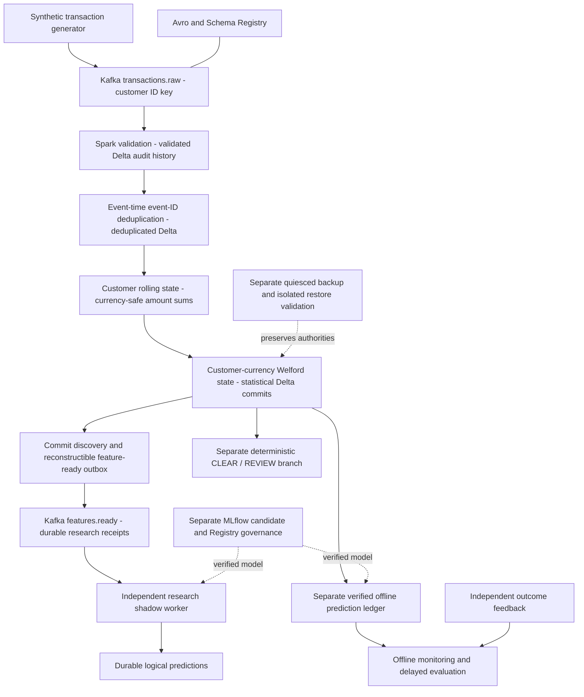

# SentinelAegisForge

**A local engineering portfolio for trustworthy streaming features and auditable ML research.** Synthetic transactions travel through Kafka, stateful Spark processing and Delta Lake into an independent research inference worker. The engineering contribution is explicit correctness at each boundary: event-time state, currency-safe history, retry identities, uncertain delivery, model provenance and tested recovery.

The platform demonstrates bounded local workflows, not a production fraud-prevention service. Transaction-side risk dispositions and model predictions are advisory and non-enforcing. The registered model is **research-only and production-ineligible**.

**Start here:** [three-minute overview](docs/portfolio/interview-defense.md#three-minute-overview) · [one real event](docs/portfolio/architecture-walkthrough.md#one-recorded-event) · [correctness and recovery](docs/portfolio/correctness-and-recovery.md) · [claim-to-evidence index](docs/portfolio/evidence-index.md).

## Architecture



**Module A — `streaming-engine`:** Scala owns transaction validation, Avro/Kafka transport, Spark state and durable features. **Module B — `model-control-plane`:** Python owns immutable datasets/training evidence, model governance, commit discovery, research inference and offline monitoring. The research branch neither supplies labels from risk rules nor blocks upstream feature commits. Monitoring consumes its separate verified offline prediction ledger; incremental shadow results are not automatically fed into it. These are bounded `AvailableNow`/operator invocations, not an unattended deployment. [Full walkthrough](docs/portfolio/architecture-walkthrough.md).

## Six engineering highlights

| Contribution | Inspect the implementation and tests | Recorded evidence |
|---|---|---|
| Event-time and currency correctness | [Rolling processor](streaming-engine/src/main/scala/io/sentinelaegisforge/streaming/processing/rollingfeatures/RollingFeatureProcessor.scala), [Welford processor](streaming-engine/src/main/scala/io/sentinelaegisforge/streaming/processing/statisticalfeatures/CustomerAmountStatisticsProcessor.scala), [state tests](streaming-engine/src/test/scala/io/sentinelaegisforge/streaming/processing/statisticalfeatures/StatisticalFeatureStreamingSpec.scala) | [Prior-only semantics and retained state](docs/portfolio/correctness-and-recovery.md#stateful-spark-correctness) |
| Transactional Delta retry protection | [Sink](streaming-engine/src/main/scala/io/sentinelaegisforge/streaming/persistence/delta/DeltaTransactionSink.scala), [sink tests](streaming-engine/src/test/scala/io/sentinelaegisforge/streaming/persistence/delta/DeltaTransactionSinkSpec.scala) | [Real post-commit recovery](docs/portfolio/correctness-and-recovery.md#real-statistical-post-commit-recovery) |
| Honest Kafka delivery semantics | [Publisher](streaming-engine/src/main/scala/io/sentinelaegisforge/streaming/kafka/featureavailability/FeatureReadyKafkaPublisher.scala), [receipt/offset tests](streaming-engine/src/test/scala/io/sentinelaegisforge/streaming/kafka/featureavailability/FeatureReadyTransportSpec.scala) | [Four failure windows](docs/portfolio/correctness-and-recovery.md#four-cross-system-failure-windows) |
| Verified research inference | [Worker](model-control-plane/src/sentinelaegisforge_control_plane/incremental_shadow/worker.py), [worker tests](model-control-plane/tests/test_incremental_shadow.py) | [Recorded event-to-result trace](docs/portfolio/architecture-walkthrough.md#one-recorded-event) |
| Recovery and bounded backpressure | [Reliability operations](model-control-plane/src/sentinelaegisforge_control_plane/reliability/operations.py), [failure tests](model-control-plane/tests/test_reliability.py) | [Phase 29 reconciliation and parity](docs/portfolio/evidence-index.md#measured-results-and-provenance) |
| Consistent backup and isolated restore | [Recovery runtime](model-control-plane/src/sentinelaegisforge_control_plane/recovery/runtime.py), [recovery tests](model-control-plane/tests/test_recovery.py) | [Phase 31 restoration boundary](docs/portfolio/correctness-and-recovery.md#isolated-restoration) |

## Technology stack

| Responsibility | Implemented stack |
|---|---|
| Transaction contracts and transport | Scala 2.13.18 / JDK 21, Avro 1.12.2, Kafka 4.3.1, Schema Registry 8.3.2 |
| Processing and state | Spark 4.2.0 Structured Streaming, RocksDB for `transformWithState` |
| Durable data | Delta Lake 4.4.0; Python 3.13, delta-rs (`deltalake` 1.6.6), PyArrow 25.0.1 |
| Offline model research | pandas 3.0.6, scikit-learn 1.9.1, MLflow 3.17.0, skops 0.16.0 |
| Local infrastructure and verification | Docker Compose, sbt 2.0.9, ScalaTest, uv, pytest, Ruff, mypy, GitHub Actions |

Pins and transitive resolution live in [Scala build](streaming-engine/build.sbt), [Python project](model-control-plane/pyproject.toml), [uv.lock](model-control-plane/uv.lock) and [Compose](docker-compose.yml). Versions alone do not establish secure or production-ready operation.

## Guarantees and their boundaries

| Boundary | Established within the tested local contract | Not established |
|---|---|---|
| Business deduplication | `event_id` suppression within watermark-retained state | Lifetime uniqueness or conflicting-payload detection |
| Spark → Delta | Stable `txnAppId` + batch ID suppress retry appends | Atomicity across all tables or systems |
| Delta → Kafka | Committed history and outbox support publication recovery | Atomic distributed transaction or duplicate-free physical delivery |
| Kafka → receiver | Durable receipt precedes offset commit; replay verifies identity | Exactly-once physical delivery or multi-host receipt authority |
| Model inference | Verified source/candidate and durable logical result reuse | Exactly-once physical invocation or production fraud quality |
| Recovery | Isolated Docker restoration and pending-work continuation | Independent-media disaster recovery, HA or an RPO/RTO promise |
| Model governance | Research-only eligibility enforced in supported workflows | Production approval or authenticated external outcome truth |

[Detailed semantics, tests and limitations](docs/portfolio/correctness-and-recovery.md) include the storage-retention and cooperating-writer assumptions behind these claims.

## Selected measured results

- **Phase 29:** 3,560 synthetic events reconciled across four experiments (1,500 / 2,000 / 30 / 30). **2,393** eligible predictions matched independent scoring with zero mismatches; other terminal results were explicitly out of scope.
- **Phase 29 Experiment C:** ten statistical rows committed before an injected failure; the same checkpoint/transaction identity recovered to **30 unique rows** with verified prior state.
- **Phase 31:** an isolated restore resumed **30 events**; **30 probability comparisons, zero mismatches**. Backup coverage was 23 dependency nodes, 5,006 local files and 424 Kafka archive entries. The backup remained on the same disk.
- **Latest full regression, Phase 31:** **327 Python tests + 122 Scala tests in 22 Scala suites = 449 tests**. Phase 32 validates documentation, not a new full regression run.

[Result sources and retained-artifact inventory](docs/portfolio/evidence-index.md#measured-results-and-provenance). These are controlled correctness observations, not throughput, availability or production-safety claims.

## Model governance and limitations

The registered candidate remains `REGISTERED_RESEARCH_ONLY`, `production_eligible=false`, and `NOT_ELIGIBLE_FOR_PROMOTION`. Of the ten Phase 18 requirements, only **VAL001–003** (integrity, reconstruction, provenance) are VERIFIED; **VAL004–010** remain NOT_ESTABLISHED. Later research shadow execution and restoration do not amend that dossier.

Synthetic evaluation demonstrates the integration, not fraud effectiveness. There is no customer payment action, production model service, automatic promotion or retraining. Local plaintext RF-1 infrastructure, trusted artifact loading and retained filesystem histories remain material constraints. [Model lifecycle](docs/portfolio/architecture-walkthrough.md#model-lifecycle-and-governance) · [security assessment](docs/assessments/phase30/architecture-threat-model.md) · [ten validation gates](docs/assessments/phase30/capability-matrix.md#model-readiness--all-ten-phase-18-requirements).

## Quick verification

Install/select JDK 21, sbt (project pins 2.0.9), Python 3.13 (verified patch 3.13.9), uv and Make. Confirm the selected Java runtime; do not change a global Java default just for this project. Scala and Python dependencies are resolved by their module tools.

```sh
java -version
uv --version
make verify-python
make verify-scala
make verify
```

Ordinary verification runs local code/Spark/Delta/SQLite tests and lint/type/format checks; **Kafka, Docker and the MLflow UI are not required**. Initial dependency resolution needs network/cache access. To force all Scala tests rather than reuse sbt's incremental cache:

```sh
cd streaming-engine
sbt "Test / testOnly *"
```

[CI configuration](.github/workflows/ci.yml) defines separate module checks; no current hosted-CI result is implied here. [Reproducibility levels and integration prerequisites](docs/portfolio/README.md#reproducibility-levels) distinguish fresh-clone checks from retained historical evidence.

## Walkthrough and detailed documentation

- [Portfolio entry points and safe developer commands](docs/portfolio/README.md)
- [Architecture and one real transaction](docs/portfolio/architecture-walkthrough.md)
- [State correctness, four delivery windows, failure recovery and restore](docs/portfolio/correctness-and-recovery.md)
- [Implementation / test / ADR / result index](docs/portfolio/evidence-index.md)
- [Three-, ten- and twenty-minute interview guide](docs/portfolio/interview-defense.md)
- [Architecture overview and implementation history](docs/architecture/overview.md) · [all 44 ADRs](docs/adr/README.md)
- [Phase 30 assessment](docs/assessments/phase30/executive-assessment.md) · [Phase 31 restore guide](docs/architecture/recovery-bundle-and-restore.md) · [preserved project history](PROJECT_STATE.md)
