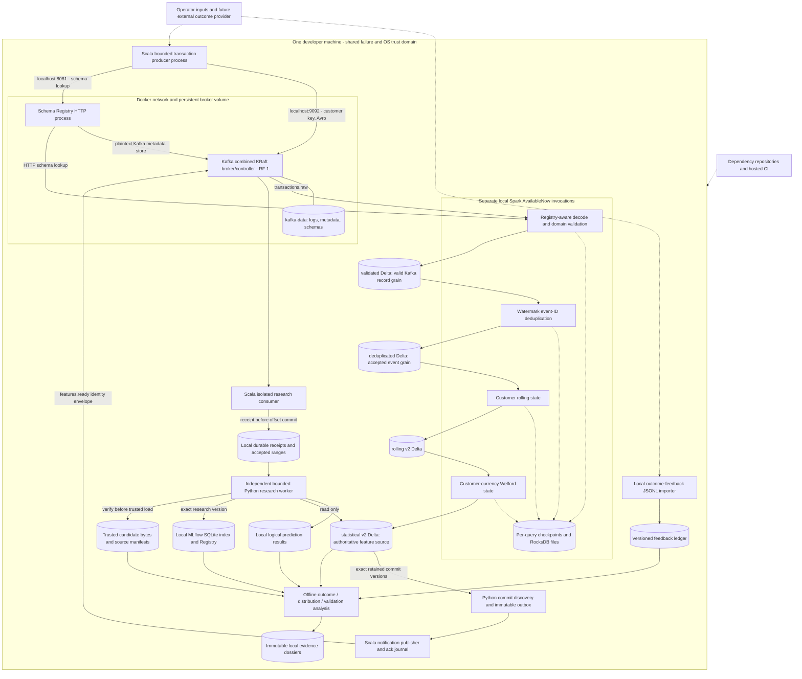

# Current architecture and trust boundaries

This is a source-backed review, not a penetration test. Evidence classifications and the inspected revision are defined in the [executive assessment](executive-assessment.md). **T/L/N/X** below mean IMPLEMENTED_AND_TESTED / IMPLEMENTED_LOCALLY / NOT_ESTABLISHED / NOT_APPLICABLE_TO_CURRENT_SCOPE. Controls proposed here are not installed by Phase 30.

## Current-state diagram

**T/L / repository and local evidence:** [Compose][compose], [Spark applications][apps], [outbox][outbox], [consumer][consumer], [worker][worker], [feedback][feedback], [Registry][registry], [ADR-038–043](../../adr/README.md). Arrows represent data or verification access, not atomic transactions or deployed cloud services. Separate invocations share the same OS identity/storage by default; process separation is not an authorization boundary. The optional Phase 11 advisory Delta branch and Phase 8 diagnostic branch are deliberately off the research inference path. Labels/private truth are outside Kafka transactions and feature state.

## Boundaries and ownership

| Boundary | Current owner/source of truth | Trust and shared-fate consequence |
|---|---|---|
| Producer → transaction Kafka | Module A validates candidates; Kafka owns accepted transport coordinates | **T/L:** key/value checks constrain shape. **N:** caller identity/authenticity. `acks=all` on RF 1 has one replica's availability. [Producer config][producer], [Compose][compose]. |
| Registry → producer/decoder | Canonical Avro in Git, explicit `transactions.raw-value` registration; `_schemas` in Kafka | **L:** compatible schema lookup. **N:** authenticated schema administrator. Registry and transactions share broker loss. [Provisioner][provision], [decoder][decoder]. |
| Spark → local Delta and checkpoint | Each query owns its table/checkpoint/txnAppId; statistical v2 owns feature truth | **T/L:** versioned state and sink retries. **N:** storage isolation between users or redundancy. Shared filesystem failure affects output and replay state together. [Sink][sink], [Make paths][make]. |
| Delta → outbox → Kafka | Delta commit is authoritative; outbox/journal are verified recovery projections | **T:** exact membership and fingerprints. A privileged writer of source plus manifests can forge the whole chain; SHA-256 supplies no sender authority. [Discovery][discovery], [outbox][outbox], [ADR-039][adr39]. |
| Kafka → receipts → worker | Scala receipts prove acceptance; Python logical results prove completed research processing | **T/L:** durable local identity checks. **N:** distributed uniqueness/ownership or an authenticated caller. No payment consumer exists. [Receipt store][receipts], [worker][worker]. |
| Registry/artifacts → model load | Phase 12/13 artifacts remain authoritative; Registry is an index to trusted candidate files | **T:** runtime/tree/type checks. **N:** signed supply chain or malicious-model sandbox. Local privileged access can replace both evidence and model. [Candidate][candidate], [ADR-030][adr30]. |
| Outcome input → monitoring | Provider/case/revision envelope and fixed Delta event universe | **T:** revision consistency, causality and conflicts. **N:** provider authentication or attested receipt time; fixture strings are assertions, not credentials. [Feedback][feedback], [ADR-036][adr36]. |

There are no production credentials required by the present local configuration. Cluster IDs, model IDs and hashes are identifiers, not secrets. No secret values were queried or printed. Future provider/service credentials would belong at the acquisition/network boundary, not in transaction events, manifests, command arguments or checked-in configuration. This is a proposed control, not a claim of an existing secrets service.

## Security control review

| ID / item | Current evidence and exposure | Consequence / recommended control | Scope |
|---|---|---|---|
| S01 Kafka authentication | **N:** listener map is PLAINTEXT; no SASL/client-auth config in [Compose][compose] or [producer][producer] | A reachable unauthorized client is not authenticated. Before shared deployment, use service identities and verified encrypted authentication. | Conditional P0 before untrusted access; local synthetic loopback experiment may remain contained. |
| S02 Kafka authorization | **N:** no authorizer/ACL provisioning; [topic script][topic] is administrative CLI access | Unauthorized writes/reads/deletions or group manipulation. Deny-by-default topic/group privileges; separate provisioning from runtime writers. | Deployment gate, not a request to configure credentials now. |
| S03 Broker TLS | **N:** host/internal/controller listeners plaintext [Compose][compose] | Traffic confidentiality/integrity against network peers absent. Secure broker/client/controller links for a selected deployment. | Conditional P0 beyond trusted local network. |
| S04 Schema Registry authentication | **N:** HTTP endpoint, no configured REST or Kafka-store auth [Compose][compose] | Reachable caller can request schema operations without a project principal. Require authenticated REST and broker-store identity. | Shared/deployed gate. |
| S05 Schema Registry authorization | **N:** subject compatibility is governance, not access control [provisioner][provision] | Unauthorized subject/config deletion or replacement can halt/poison decoding. Restrict runtime readers and approved schema writers. Evaluate supported authorization/licensing for the selected distribution. | Shared/deployed gate. |
| S06 Delta access | **N:** path-based local files, no table ACL/catalog authorization [reader][reader], [sink][sink] | Reading transaction metadata or altering files/logs is bounded only by OS access. Separate runtime users and restricted data roots; design storage IAM only if moving hosts/cloud. | Real-data P0. |
| S07 Local files | **L:** inspected `.local` and dossier modes 0755, SQLite file 0644; no uniform restrictive mode in [artifact publication][publication] | These modes alone are not proof another user can traverse parent directories; ancestor ACLs/FileVault were not inspected. Establish explicit ownership/modes and a threat model before real data. | Local hygiene useful; real-data P0. |
| S08 Model artifact access | **T:** [candidate loader][candidate] rejects symlinks, unexpected trees/runtime/types and verifies hashes; static `numpy.dtype` trust list | No authorization/signature or isolated deserialization process. A compromised trusted writer defeats colocated hashes. Protect origin/bytes and isolate loading before accepting external candidates. | Current trusted-local constraint must remain; shared artifact use P0. |
| S09 MLflow Registry | **T:** [local writer locks][registry] and strict read-back; **L:** [UI target][make] binds localhost | External database/UI writers need not honor flock; tags mutable. Separate readers/admins, audit changes, protect SQLite/backups; authenticated service only if deliberately deployed. | Local multiwriter reliability P1; deployment P0. |
| S10 Secrets and CI credentials | **T:** [CI][ci] has `contents: read`, no explicit deploy secret usage; **N:** repository secret settings and rotation | Keep no credentials in fixture/logs; use scoped short-lived identity and protected environments if releases need credentials. No secret manager is justified just for today's secret-free stack. | Deployment gate; no secret configuration in this review. |
| S11 Containers | **L:** no privileged mode, host Docker socket mount or extra host port in [Compose][compose]; **N:** explicit user/capability drop/read-only root/memory quota policy | Image defaults supply execution identity; actual runtime UID/capabilities not inspected. Test minimal permissions/resource bounds when packaging a deployment. | Containment hardening before shared operation; do not assert current containers run as root. |
| S12 Supply chain | **T:** pins and uv hashes; **N:** security scanner, signed release provenance; Actions/images remain tags [CI][ci], [lock][lock], [build][build] | A dependency/action compromise runs in build/test trust. Immutable references, reviewed updates, vulnerability triage and release provenance; no claim current pins are vulnerability-free. | High-value P1 CI improvement. |
| S13 Network exposure | **L:** only 127.0.0.1 host ports 9092/8081; optional UI localhost; internal network has unprotected listeners [Compose][compose], [Make][make] | Loopback reduces exposure but local processes/tunnels/attached containers still cross no auth boundary. Keep bindings; review Spark/UI transient endpoints and host firewall before shared execution. | Current synthetic boundary; external exposure requires S01–S12. |

**External recommendations, not repository evidence:** Kafka documents authentication, authorization and encryption as separate mechanisms ([Kafka 4.3 security](https://kafka.apache.org/43/security/security-overview/)). Schema Registry REST security and Kafka-store security are distinct; authorization options depend on the selected platform ([Confluent security](https://docs.confluent.io/platform/current/schema-registry/security/index.html)). No blanket compliance or security certification follows from enabling one setting.

## Focused threat model

All attacks below are credible **inferences**, not observed compromises. Current defenses are T where linked tests exercise them; missing adversarial guarantees are N. I = integrity, C = confidentiality, A = availability, Z = authorization.

| Scenario / property | Established defense | Missing control and plausible impact | Priority / evidence |
|---|---|---|---|
| Forged `features.ready` notification (I/Z/A) | Canonical bytes, key/ready-ID, batch membership, row fingerprint and pinned-source checks | No producer ACL/auth; foreign records fail the strict batch range and can stall consumption. Coherent source+manifest forgery defeats hashes. | P0 before shared network; [codec][codec], [consumer][consumer], [transport tests][transport-tests]. |
| Unauthorized candidate replacement (I/Z) | Tree/runtime/source hash checks and exact Registry version | Same privileged actor can replace all local claims; no signed trust root or access separation. | P0 before external artifacts; [candidate][candidate], [candidate tests][candidate-tests]. |
| Malicious serialized model (I/C/A) | skops format, static type list, expected Pipeline, verification before loading | No hostile-model sandbox/resource deadline. Never accept arbitrary artifact+manifest merely because internally consistent. | P0 before untrusted models; [ADR-030][adr30]. |
| Poisoned feedback (I/Z) | Unknown event/revision conflicts and causality rejected | Plausible forged confirmed outcomes can pass mechanics; source name and supplied receipt time are not authenticated. | P0 before real-label claims; [feedback tests][feedback-tests], [ADR-036][adr36]. |
| Topic delete/recreate (A/I) | Cluster/topic identity and retained-range fences fail closed | No broker ACL or backup; recreated topic cannot restore original offsets just by reusing its name. | P1 restore; P0 shared admin boundary; [retention][retention], [tests][reliability-tests]. |
| Wrong group or topic (I/A) | Config and source/group identities, three-partition acquisition and accepted-offset continuity | No protected ownership; unauthorized group-offset changes or competing consumers disrupt the single-member contract. | P1 ownership; [operational transport][operational], [ADR-041][adr41]. |
| Replay of stale valid messages (I/A) | Logical ready/request identities reuse receipts/results; source/window checks | Retained source required; repeated physical traffic costs resources. No unlimited retention or global lifetime replay defense. | P1 retention; [worker][worker], [worker tests][worker-tests]. |
| Local artifact edits (I/A) | Canonical encoding, exclusive claims, exact inventory and content hashes | No independent attestation; coherent privileged rewrite undetectable against only colocated hashes. | P1 independent backup; P0 real-data privileges; [publication][publication], [evidence inspector][inspector]. |
| Transaction metadata disclosure (C) | Feature allowlist excludes IDs from estimator; ready envelopes omit full features | Raw Kafka/Delta, traces and linked IDs remain sensitive. Estimator exclusion is not anonymization. | P0 real-data access/retention; [schema][schema], [results][results]. |
| Compromised CI dependency/action (I/C/Z) | Locked Python dependencies, pinned coordinates, read-only repository token | Tags mutable; no attestations/scanning. Tests execute dependency code and cannot prove it benign. | P1 CI; [workflow][ci]. |
| Future leaked infrastructure credential (C/I/Z) | No project deployment credential presently configured | Rotation/revocation/audit process absent; a later secret must not widen rights silently. | Conditional P0; [Compose][compose], [workflow][ci]. |

## Privacy and data governance inventory

**Repository-proven content; NOT_ESTABLISHED real-data governance:** [Avro schema][schema], [Delta schema][delta-schema], [feature contract][feature-contract], [research results][results], [feedback contract][feedback-contract], [trace collector][trace].

- `transactions.raw` and validated/dedup/feature tables carry event, transaction, customer, merchant, device and IP identifiers, monetary amounts/currency, event/ingestion times and Kafka lineage. They would reveal transaction behavior if populated with real data.
- The 11 estimator features exclude direct identity/Kafka/label metadata, but derived statistical behavior and low-cardinality attributes are not automatically anonymous. Full feature-source rows and offline snapshots retain audit columns outside the model projection.
- Ready envelopes and receipts omit features/labels but retain event IDs, table/version fingerprints and transport coordinates. Prediction results bind event/candidate identities and probability; they can be rejoined to source transactions.
- Full event traces, local debug/inspection logs and manifests can contain transaction-linked values, source paths or case identifiers. Dossiers normally retain compact evidence instead of private truth, but a hash does not make a linked identifier non-sensitive. Raw labels/private simulator truth are not copied into Phase 29's dossier.
- Feedback ledgers retain provider-record/case IDs, revisions, outcomes and observation times. Monitoring aggregates can expose small segments; current support gates protect metric interpretation, not a proven privacy guarantee.

**Proposal before real data:** identify data owners and authorized purpose, minimize retained raw identifiers, restrict read/write roles and logs, encrypt appropriate stores/transport, establish dependent-artifact retention and deletion handling, and audit authorized access. Immutable research manifests and deletion obligations require an explicit governance design rather than silent removal of referenced files. No jurisdiction-specific legal requirement or certification is asserted; qualified review would be needed after choosing data, users and deployment jurisdiction. [Retention dependencies](failure-mode-register.md#stateful-upgrades-and-retention-dependencies).

[compose]: ../../../docker-compose.yml
[apps]: ../../../streaming-engine/src/main/scala/io/sentinelaegisforge/streaming/processing
[outbox]: ../../../model-control-plane/src/sentinelaegisforge_control_plane/availability/outbox.py
[discovery]: ../../../model-control-plane/src/sentinelaegisforge_control_plane/availability/discovery.py
[consumer]: ../../../streaming-engine/src/main/scala/io/sentinelaegisforge/streaming/kafka/featureavailability/FeatureReadyKafkaConsumer.scala
[worker]: ../../../model-control-plane/src/sentinelaegisforge_control_plane/incremental_shadow/worker.py
[feedback]: ../../../model-control-plane/src/sentinelaegisforge_control_plane/feedback/ingestion.py
[registry]: ../../../model-control-plane/src/sentinelaegisforge_control_plane/registry/run.py
[producer]: ../../../streaming-engine/src/main/scala/io/sentinelaegisforge/streaming/kafka/producer/TransactionProducerConfig.scala
[provision]: ../../../scripts/provision-schema-registry.sh
[decoder]: ../../../streaming-engine/src/main/scala/io/sentinelaegisforge/streaming/kafka/ingestion/RegistryBackedTransactionDecoder.scala
[sink]: ../../../streaming-engine/src/main/scala/io/sentinelaegisforge/streaming/persistence/delta/DeltaTransactionSink.scala
[make]: ../../../Makefile
[receipts]: ../../../streaming-engine/src/main/scala/io/sentinelaegisforge/streaming/kafka/featureavailability/FeatureReadyReceiptStore.scala
[candidate]: ../../../model-control-plane/src/sentinelaegisforge_control_plane/candidates/run.py
[adr30]: ../../adr/ADR-030-reproducible-model-artifacts.md
[adr36]: ../../adr/ADR-036-durable-outcome-feedback-ingestion.md
[adr39]: ../../adr/ADR-039-feature-ready-kafka-transport.md
[adr41]: ../../adr/ADR-041-incremental-shadow-operations-and-backpressure.md
[topic]: ../../../scripts/provision-feature-ready-topic.sh
[reader]: ../../../model-control-plane/src/sentinelaegisforge_control_plane/datasets/feature_source.py
[publication]: ../../../model-control-plane/src/sentinelaegisforge_control_plane/availability/contract.py
[ci]: ../../../.github/workflows/ci.yml
[lock]: ../../../model-control-plane/uv.lock
[build]: ../../../streaming-engine/build.sbt
[codec]: ../../../streaming-engine/src/main/scala/io/sentinelaegisforge/streaming/kafka/featureavailability/FeatureReadyCodec.scala
[transport-tests]: ../../../streaming-engine/src/test/scala/io/sentinelaegisforge/streaming/kafka/featureavailability/FeatureReadyTransportSpec.scala
[candidate-tests]: ../../../model-control-plane/tests/test_candidates.py
[feedback-tests]: ../../../model-control-plane/tests/test_feedback.py
[retention]: ../../../model-control-plane/src/sentinelaegisforge_control_plane/reliability/retention.py
[reliability-tests]: ../../../model-control-plane/tests/test_reliability.py
[operational]: ../../../streaming-engine/src/main/scala/io/sentinelaegisforge/streaming/kafka/featureavailability/FeatureReadyOperationalTransport.scala
[worker-tests]: ../../../model-control-plane/tests/test_incremental_shadow.py
[inspector]: ../../../model-control-plane/src/sentinelaegisforge_control_plane/reliability/evidence.py
[schema]: ../../../contracts/events/transaction-event-v1.avsc
[results]: ../../../model-control-plane/src/sentinelaegisforge_control_plane/kafka_shadow/results.py
[delta-schema]: ../../../streaming-engine/src/main/scala/io/sentinelaegisforge/streaming/persistence/delta/ValidatedTransactionDeltaSchema.scala
[feature-contract]: ../../../model-control-plane/src/sentinelaegisforge_control_plane/datasets/dataset_contract.py
[feedback-contract]: ../../../model-control-plane/src/sentinelaegisforge_control_plane/feedback/contract.py
[trace]: ../../../model-control-plane/src/sentinelaegisforge_control_plane/stateful_shadow_integration/reconciliation.py
